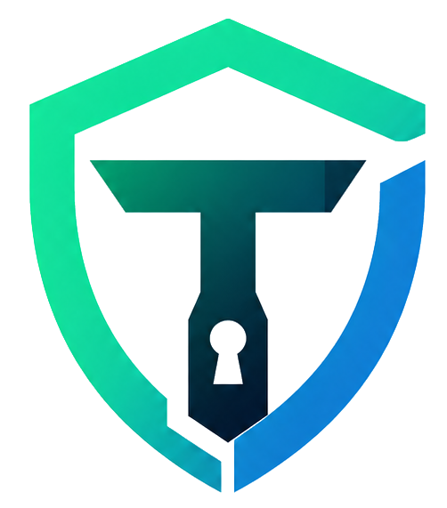
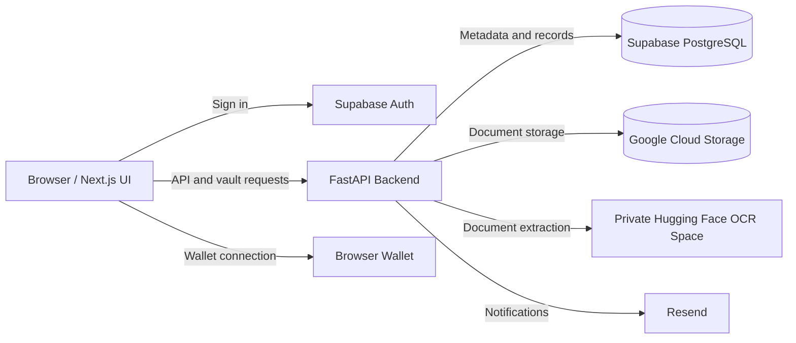

<div align="center">
  
  <h1>TRUSTIX</h1>
  <p><strong>Your digital legacy. Organized today, accessible when it matters.</strong></p>
  <p>A digital-inheritance workspace for protected documents, trusted nominees, and controlled vault access.</p>
  <p>
    <a href="#quick-start">Quick Start</a> &middot;
    <a href="#features">Features</a> &middot;
    <a href="#architecture">Architecture</a> &middot;
    <a href="#docker">Docker</a> &middot;
    <a href="#current-limitations">Project Status</a>
  </p>
</div>

---

> **Status: MVP / active development.** Trustix includes working application code,
> integration scaffolding, and development previews. It is not an audited
> inheritance service, legal instrument, or production-ready custody platform.
> Use synthetic documents and test wallets while evaluating it.

## Overview

Important documents, account information, and digital assets often become hard
to locate or access when their owner is unavailable. Trustix explores a single
workspace where an owner can organize that information, designate trusted
nominees, and manage the conditions surrounding access.

The project brings together a Next.js dashboard, a FastAPI backend, Supabase
authentication and database storage, Google Cloud Storage, and a separately
hosted document-extraction service. Its long-term direction is controlled
digital inheritance, not simply another file-upload dashboard.

### Intended Workflow

1. Sign in and create a vault with a generated identifier and owner secret.
2. Add trusted nominees and distribute their access credentials securely.
3. Upload documents and manage their metadata through the workspace.
4. Extract document text with OCR and review the results.
5. Access protected documents through the owner or nominee workflow.
6. Download reports or vault backups for offline reference.

Automatic inheritance release is a product direction, not a completed guarantee
of this implementation. See [Current Limitations](#current-limitations).

## Features

| Area | What the code provides |
| --- | --- |
| Dashboard | Overview metrics, activity summaries, navigation, and responsive workspace layouts. Development mode supports a sample-data preview. |
| Vault creation | Generated vault codes and owner secrets, bcrypt key hashing, and nominee registration. |
| Document management | PDF upload, listing, download, and deletion; separate preservation flows for original PDF, PNG, and JPEG documents. |
| Nominee access | Owner/nominee access flows, temporary vault sessions, failed-attempt lockout, and an OCR verification step. |
| Key-protected data | A dedicated `/zk-vault` API using bcrypt and AES-GCM. The name does not imply complete zero-knowledge operation. |
| OCR | Backend-proxied extraction using IBM Granite Docling 258M, with text, Markdown, page counts, timing, and incomplete-output warnings. |
| Wallet integration | Browser-wallet connection through ethers, wallet-address linking, signature verification, and encrypted wallet-storage endpoints. |
| Reports and downloads | PDF, CSV, and JSON workspace exports; OCR text/Markdown/PDF exports; downloadable vault backup PDFs. |
| Workspace administration | Pages for access control, compliance, activity, risk monitoring, reports, and organization settings. |
| Notifications | Resend integration code for vault and nominee notifications, requiring runtime credentials and sender configuration. |
| Operations | Public process-liveness endpoint, browser keep-alive checks, optional scheduled health requests, and service Dockerfiles. |

Vault backup PDFs may contain access secrets. Treat them as sensitive credentials,
not ordinary reports, and do not commit or share them publicly.

## Architecture



The browser uses public Supabase configuration and communicates with the backend.
The backend holds privileged database and OCR credentials. The OCR model runs
in its own service, keeping model dependencies out of the main API image.
Documents sent for OCR are processed on the configured external provider.

### Technology Stack

| Layer | Technologies |
| --- | --- |
| Frontend | Next.js 15, React 18, TypeScript |
| Interface | Tailwind CSS, Radix UI, Lucide, Framer Motion, Recharts |
| Client data | TanStack Query, Axios/fetch, Supabase JavaScript client |
| Backend | Python, FastAPI, Uvicorn, Pydantic, SlowAPI |
| Identity and data | Supabase Auth, PostgreSQL, PostgREST |
| Storage | Google Cloud Storage |
| Cryptography | cryptography/AES-GCM, bcrypt, PyCryptodome, JWT libraries |
| OCR | `ibm-granite/granite-docling-258M`, private Docker Space |
| Wallets | ethers, eth-account |
| Export | jsPDF, jsPDF-AutoTable, bundled Noto Sans font |
| Tests | Vitest, Testing Library, Python unittest |
| Containers | Python 3.11 backend image, Node.js 22 multi-stage frontend image |

## Repository Layout

```text
Trustix/
|-- frontend/
|   |-- app/                    Next.js entry points, layout, and providers
|   |-- src/views/              Landing, authentication, and dashboard pages
|   |-- src/components/         Shared UI, navigation, and vault components
|   |-- src/contexts/           Authentication and vault state
|   |-- src/lib/                Exports, PDF generation, and keep-alive helpers
|   |-- public/                 Branding, media, and licensed font assets
|   |-- Dockerfile              Standalone production frontend image
|   `-- .env.example            Public browser configuration template
|-- backend/
|   |-- app/routes/             API endpoints
|   |-- app/services/           Database, storage, OCR, email, and encryption
|   |-- app/middleware/         Vault-session authorization helpers
|   |-- app/utils/              Key generation and cryptographic utilities
|   |-- app/workers/            Inactivity-monitoring implementation
|   |-- tests/                  Health and OCR tests
|   |-- docs/                   Integration notes
|   |-- supabase_schema.sql     Database schema reference
|   |-- zk_vault_setup.sql      Standalone key-protected-vault table reference
|   `-- Dockerfile              API container image
|-- deploy/
|   |-- huggingface-ocr/        Standalone OCR service and model configuration
|   `-- deploy_ocr_space.py     Private Space deployment helper
`-- .github/workflows/          Optional Render keep-alive workflow
```

## Quick Start

### Prerequisites

- Python 3.11, matching the backend container runtime.
- Node.js 22 and npm, matching the frontend container runtime.
- A Supabase project for authenticated, persistent workflows.
- GCS credentials for real document storage.
- An independently deployed OCR Space for Granite document extraction.
- Docker Desktop with Linux containers, only if using Docker.

The dashboard preview can be explored without all integrations, but real API
operations require their corresponding credentials and database tables.

### 1. Get the Project

```powershell
git clone https://github.com/NexVed/Trustix.git
cd Trustix
```

Already working in this repository? Continue with the backend setup.

### 2. Configure and Start the Backend

In a terminal at the repository root:

```powershell
cd backend
python -m venv venv
.\venv\Scripts\Activate.ps1
python -m pip install -r requirements.txt
if (-not (Test-Path .env)) { Copy-Item .env.example .env }
```

Create `.env` only if one does not already exist, then replace the placeholders.
Never overwrite working credentials just to repeat setup.

Start the API after configuring the environment:

```powershell
python -m dotenv -f .env run -- python -m uvicorn app.main:app --host 127.0.0.1 --port 8000 --reload
```

The dotenv launcher also exposes values to services that read `os.environ`
directly, rather than only through Pydantic settings.

### 3. Configure and Start the Frontend

In a second terminal at the repository root:

```powershell
cd frontend
npm ci
if (-not (Test-Path .env)) { Copy-Item .env.example .env }
```

Again, preserve any existing `.env`. Configure these browser-public values:

```env
NEXT_PUBLIC_SUPABASE_URL=https://your-project.supabase.co
NEXT_PUBLIC_SUPABASE_ANON_KEY=your-public-supabase-anon-key
NEXT_PUBLIC_API_URL=http://localhost:8000
```

```powershell
npm run dev
```

| Service | Local URL |
| --- | --- |
| Frontend | http://localhost:8080 |
| Dashboard | http://localhost:8080/dashboard |
| Backend | http://localhost:8000 |
| API explorer | http://localhost:8000/docs |
| Health endpoint | http://localhost:8000/health |

If port 8080 is occupied, use `npx next dev -p 8081`. If the API port changes,
update `NEXT_PUBLIC_API_URL` and restart the frontend.

On macOS/Linux, use `source venv/bin/activate` and `cp` instead of the PowerShell
activation and copy commands. The Python and npm commands are otherwise the same.

### Development Preview

Under `npm run dev`, `/auth` currently redirects to `/dashboard`, and most
dashboard pages can be viewed without signing in. Some screens display sample
data. This is a development-only design preview, not authenticated API access.
Backend authorization still applies, and production builds protect dashboard
routes. Do not remove backend checks to make preview actions succeed.

### Database Setup

Review [supabase_schema.sql](backend/supabase_schema.sql) and
[zk_vault_setup.sql](backend/zk_vault_setup.sql) before initializing a database.
They are schema references, not a versioned migration pipeline.

**Known setup gap:** the main schema's `vaults` definition omits fields referenced
by application code and policies, including `user_id`. The inactivity worker
also expects fields such as `last_activity_at` and `is_triggered`. Reconcile the
schema and access policies in a test project before executing it or relying on
persistent workflows. Re-running policy creation may require manual reconciliation.

## Configuration

See [backend/.env.example](backend/.env.example) and
[frontend/.env.example](frontend/.env.example) for starting templates.

| Variable | Location | Purpose |
| --- | --- | --- |
| `NEXT_PUBLIC_SUPABASE_URL` | Frontend | Public Supabase project URL. |
| `NEXT_PUBLIC_SUPABASE_ANON_KEY` | Frontend | Public anon key; never use a service-role key here. |
| `NEXT_PUBLIC_API_URL` | Frontend | Browser-reachable backend base URL. |
| `SUPABASE_URL` | Backend | Supabase project URL. |
| `SUPABASE_SERVICE_ROLE_KEY` | Backend | Privileged database access; keep secret. |
| `SUPABASE_JWT_SECRET` | Backend | HS256 secret expected by the current token verifier. |
| `FRONTEND_URL` | Backend | Additional allowed frontend origin for CORS. |
| `GOOGLE_CLOUD_BUCKET` | Backend | Bucket for encrypted uploads. |
| `GOOGLE_APPLICATION_CREDENTIALS` | Backend | Runtime path to a GCP service-account file. |
| `GCP_PROJECT_ID`, `GCP_BUCKET_NAME`, `GCP_CLIENT_EMAIL`, `GCP_PRIVATE_KEY` | Backend | Alternate GCS service configuration. |
| `DOCUMENT_MASTER_KEY` | Backend runtime | Document encryption key: 64 hexadecimal characters. Replace the development fallback. |
| `TOKEN_ENCRYPTION_KEY` | Backend runtime | Stable Fernet-compatible encryption key. Replace the sample value. |
| `WALLET_ENCRYPTION_SALT` | Backend runtime | Replace the default wallet key-derivation salt. |
| `RESEND_API_KEY` | Backend runtime | Email integration credential. |
| `OCR_PROVIDER` | Backend | `granite_docling` by default; `ocr_space` is explicit legacy opt-in. |
| `HF_OCR_URL`, `HF_TOKEN`, `HF_OCR_API_KEY` | Backend | Private Space address and authentication. |
| `HF_TOKEN_PATH` | Backend | Optional local token-file alternative to `HF_TOKEN`. |
| `HF_OCR_TIMEOUT_SECONDS` | Backend | OCR request timeout configuration. |
| `OCR_SPACE_API_KEY` | Backend | Credential for the explicitly selected legacy provider. |
| `INFURA_API_KEY`, `POLYGON_RPC_URL`, `POLYGON_AMOY_RPC_URL` | Backend | Blockchain integration configuration; not evidence of completed notarization. |

`NEXT_PUBLIC_*` values are embedded in browser code at build time. Rebuild a
production frontend after changing them. Backend-only secrets must never use
that prefix. Preserve encryption keys across restarts; changing them without a
migration can make previously encrypted data unreadable.

The current API verifier accepts HS256 tokens. Projects using asymmetric Supabase
signing keys need a compatible verifier/JWKS implementation; changing only the
project URL and public key does not address that difference.

## Dashboard Pages

| Route | Workspace |
| --- | --- |
| `/` | Public landing page |
| `/auth` | Authentication; redirects in development preview |
| `/dashboard` | Overview |
| `/asset-vault` | Asset and document management |
| `/zk-vault` | Key-protected vault |
| `/ai-verification` | Document extraction and review |
| `/nominee-governance` | Nominee management |
| `/nominee-generation` | Nominee-key workflow |
| `/blockchain` | Browser wallet and blockchain workspace |
| `/access-control` | Access management |
| `/compliance` | Compliance workspace |
| `/activity-ledger` | Activity history |
| `/risk-monitoring` | Risk workspace |
| `/reports` | Reports and exports |
| `/settings` | Organization settings |

The existence of a workspace page does not imply regulatory certification,
independent fraud detection, or a completed backend workflow for every control.

## API Guide

FastAPI exposes interactive documentation at `/docs` and its schema at
`/openapi.json`. Use those for request models and the complete endpoint list.

| API | Purpose |
| --- | --- |
| `GET /health`, `HEAD /health` | Public, non-cached process liveness; no database or model calls. |
| `POST /auth/signup-sync` | Synchronize the authenticated user's profile. |
| `POST /vault/create` | Create a vault and return generated owner credentials. |
| `POST /vault/upload` | Store an already-encrypted vault upload and content hash. |
| `GET/POST /vault/{vault_id}/nominees` | Read or add vault nominees. |
| `POST /verification/vault-access` | Validate owner or nominee credentials and issue a temporary session. |
| `POST /documents/upload` | Upload a PDF using vault-session authorization. |
| `GET /documents` | List accessible documents. |
| `GET /documents/{document_id}/download` | Download an authorized document. |
| `POST /documents/preserve-original` | Preserve an original document. |
| `GET /verification/ocr/status` | Authenticated OCR configuration status, not live model readiness. |
| `POST /verification/ocr` | Extract document text and Markdown. |
| `POST /verification/nominee-ocr` | Nominee document-check workflow. |
| `/zk-vault/*` | Initialize, verify, store, and retrieve key-protected data. |
| `/wallet/*` | Link/store wallets and verify signatures. |
| `GET /dashboard/summary` | Authenticated dashboard summary. |
| `/activities`, `/settings`, `/profile/*` | Activity records, settings, and encrypted profile storage. |
| `POST /trigger/check` | MVP inactivity-trigger simulation. |

Most account endpoints require `Authorization: Bearer <Supabase access token>`.
Document endpoints use vault-session claims and apply role checks. Consult the
endpoint implementation before assuming the two token types are interchangeable.

## OCR Service

Granite OCR is a separate private Docker Space, not a model installed inside
FastAPI. Deploying the main application does not deploy or activate this service.

- Model: `ibm-granite/granite-docling-258M`.
- Accepted documents: PDF, PNG, JPEG; maximum 10 MiB and five PDF pages in the Space.
- Output: plain text, Markdown, page count, model revision, timing, and truncation metadata.
- Concurrency: one inference request at a time; busy requests receive HTTP 429.
- Credentials: Hugging Face bearer token plus a separate OCR API key, backend only.
- Incomplete extraction is flagged; existing verification callers reject it.
- OCR extraction does not prove identity, death, ownership, or authenticity.

The service code does not persist extracted content, but uploads are processed
on Hugging Face infrastructure and may temporarily spool during request parsing.
Use synthetic documents until privacy and deployment requirements are reviewed.

See [deployment instructions](deploy/README.md) and the
[OCR service README](deploy/huggingface-ocr/README.md) for provisioning and limits.

## Docker

The [backend Dockerfile](backend/Dockerfile) runs Uvicorn as a non-root user.
The [frontend Dockerfile](frontend/Dockerfile) uses a multi-stage build and Next.js
standalone output. Both images define health checks and exclude local environment
files through `.dockerignore`.

From the repository root, with Docker's Linux engine running:

```powershell
docker build -t trustix-backend ./backend
docker run -d --name trustix-backend --env-file backend/.env -e FRONTEND_URL=http://localhost:8080 -p 127.0.0.1:8000:8000 trustix-backend
```

Build the frontend with public values for the same Supabase project:

```powershell
docker build -t trustix-frontend --build-arg NEXT_PUBLIC_SUPABASE_URL=https://your-project.supabase.co --build-arg NEXT_PUBLIC_SUPABASE_ANON_KEY=your-public-anon-key --build-arg NEXT_PUBLIC_API_URL=http://localhost:8000 ./frontend
docker run -d --name trustix-frontend -p 127.0.0.1:8080:8080 trustix-frontend
```

Replace the sample public values before building. Ports must be free. The API
URL must resolve from the browser, not only from Docker's internal network.
For remote hosting, replace localhost URLs, configure HTTPS and CORS, and rebuild.
Mount GCP or Hugging Face credential files read-only at Linux paths and update
the corresponding environment variables; host Windows paths do not work inside
containers. Containers do not provision Supabase, GCS, or the OCR Space.

## Testing and Development

Frontend, from `frontend/`:

```powershell
npm test
npx tsc --noEmit
npm run lint
npm run build
```

Backend, from `backend/` with its virtual environment activated:

```powershell
python -m pip install httpx
python -m unittest discover -s tests -p "test_*.py" -v
```

Existing automated tests cover frontend exports/PDF generation, keep-alive
behavior, backend liveness, and OCR provider/route behavior. They are not a full
security audit or end-to-end proof of storage, inheritance, or wallet safety.

## Deployment and Operations

- **Frontend:** deploy as a Next.js application or use the standalone Docker image.
  Set public environment values before building.
- **Backend:** use the Python image or run Uvicorn with production environment
  values. See [backend deployment notes](backend/README.md).
- **OCR:** deploy independently and configure its credentials on the backend.
- **Health:** `/health` checks the API process, not Supabase, GCS, or model readiness.
- **Keep-alive:** the browser requests health every five minutes while running.
  The optional [GitHub workflow](.github/workflows/render-keep-alive.yml) schedules
  ten-minute checks when `RENDER_BACKEND_URL` is configured as an Actions variable
  and the workflow is published on the default branch. Neither mechanism
  guarantees uptime or handles provider quotas and outages.

Never commit `.env` files, cloud credentials, Hugging Face tokens, private keys,
or generated vault backup PDFs. Keep production secrets in runtime secret storage.

## Current Limitations

| Area | Important boundary |
| --- | --- |
| Zero knowledge | Several flows send keys or plaintext to the backend. AES encryption alone does not make the whole system end-to-end encrypted or zero knowledge. |
| Key management | Development fallback keys/salts exist. Some notification flows include generated secrets. Replace defaults and review secret distribution before handling sensitive data. |
| Vault authorization | Account and temporary-session handling need security review, including claim separation, role enforcement, lockout, and resource ownership. |
| Nominee threshold | The current access verifier requires every registered nominee key; it does not implement general M-of-N secret sharing despite threshold-related fields elsewhere. |
| Inactivity release | A scheduler implementation exists but is not started by `app.main`. `/trigger/check` is a simulation, not an operational automatic transfer system. |
| Blockchain proof | The upload service currently generates a SHA-256 content hash, not an on-chain transaction or notarization receipt. Wallet connection does not change that. |
| Document verification | Current checks include textual heuristics and similarity. They are not validated identity verification or reliable fraud adjudication. |
| Cloud storage | One GCS service simulates upload/download behavior when unconfigured. A successful preview is not proof that a document was durably stored. |
| Database bootstrap | SQL references and current API expectations have drifted. Resolve missing columns and policies before persistent use. |
| External integrations | OCR, email, wallet history, and cloud storage need separately configured services and may have provider limits or placeholders. |
| Compliance and legality | Dashboard labels and reports do not establish compliance, legal inheritance rights, or authority to release assets. |

## Development Priorities

These are suggested next steps, not claims of completed functionality:

- Introduce versioned, tested database migrations.
- Audit authorization, signing keys, and account/vault token boundaries.
- Remove development cryptographic fallbacks and harden secret delivery.
- Define a consistent client-side encryption and recovery model.
- Implement and test a deliberate nominee threshold policy.
- Wire inactivity processing to a reliable worker with reviewed release controls.
- Replace mock blockchain proofs and verification heuristics where required.
- Add authenticated end-to-end tests and deployment smoke checks.

## Contributing

Keep changes scoped, add tests for changed behavior, and use synthetic data in
fixtures. Describe required configuration or schema changes alongside code.
For security concerns, avoid public reports containing credentials, personal
documents, or exploitable account details; arrange private disclosure with the
repository maintainer.

## License

This repository currently has no root project license file. Do not assume an
open-source license from a dependency or the OCR Space metadata. Third-party
models, packages, and bundled assets retain their own licenses; the bundled
Noto Sans font includes its [OFL license](frontend/public/fonts/OFL.txt).
